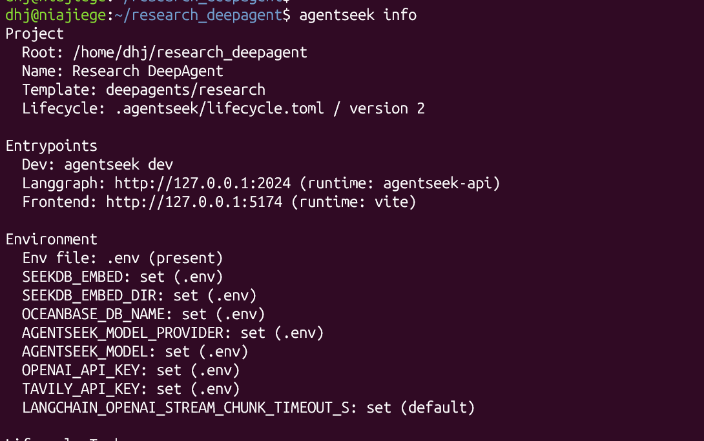
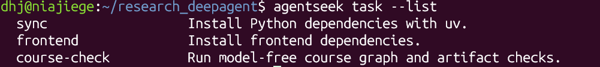
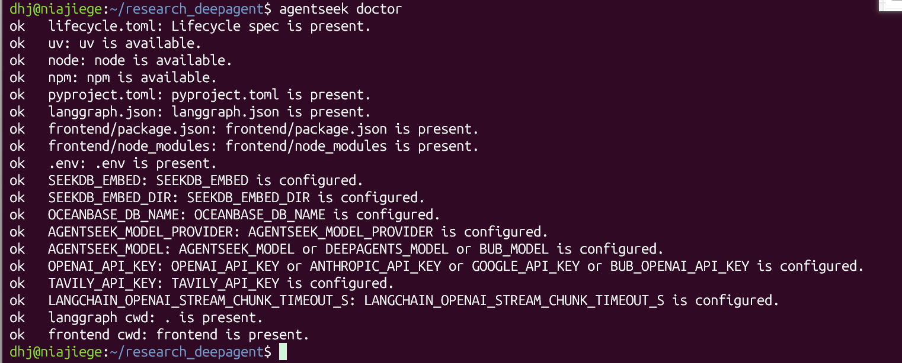
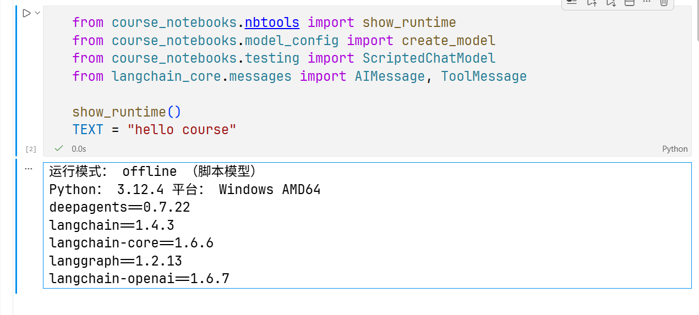

# AgentSeek 准备篇：用生命周期工作流启动 DeepAgents 模板

> **一句话**：AgentSeek 是《Deep Agents 实战》课程的模板与生命周期工具。`create` 生成项目 → `info` 看结构 → `task` 装依赖 → `doctor` 查环境 → `dev` 起前后端。全程不碰应用业务代码。
>
> **本篇环境**：WSL2 Ubuntu + Python 3.12 + uv + Node.js LTS。教程使用 AgentSeek `0.1.2` 验证（2026-08-18）。

---

## 一、AgentSeek 管什么

面向 AI 应用开发的**模板 + 生命周期**工具，省掉手搓脚手架。

每个生成的项目里都有一个 `.agentseek/lifecycle.toml`，它声明这个模板需要：

- 哪些**工具**（uv / node / npm）
- 哪些**环境变量**（模型、密钥、数据库）
- 哪些**一次性任务**（装依赖）
- 哪些**本地服务**（后端 API、前端 dev server）

AgentSeek 读这个文件做检查、装依赖、起服务，**不接管应用自己的框架代码**。

一句话记忆：**`lifecycle.toml` 是给 AgentSeek 看的说明书，`src/` 里的 Agent 代码它管不着。**

---

## 二、环境准备（WSL2）

Windows 用户别挣扎，直接 WSL2。

```bash
wsl --install          # 首次安装，完成后重启
wsl -d Ubuntu
```

进 WSL 后装三样：

```bash
# 1) uv —— Python 环境与依赖管理
curl -LsSf https://astral.sh/uv/install.sh | sh

# 2) Node.js / npm —— 装当前 LTS 版（前端要用）

# 3) AgentSeek —— 用 uv 装成全局工具
uv tool install --upgrade agentseek
```

验证：

```bash
agentseek version
agentseek --help
```

硬性要求：Python 3.12 / 3.13、uv 稳定版、Node.js + npm 当前 LTS。

---

## 三、命令速查表（背这张就够）

| 阶段 | 命令 | 作用 |
|---|---|---|
| 创建 | `agentseek create` | 从模板生成可编辑的项目 |
| 查看 | `agentseek info` | 看项目入口、环境要求、任务清单 |
| 准备 | `agentseek task` | 跑模板声明的一次性任务（装依赖） |
| 检查 | `agentseek doctor` | 静态检查文件、工具、环境变量 |
| 运行 | `agentseek dev` | 启动模板声明的本地开发进程 |

---

## 四、创建项目

```bash
# 先看有哪些模板
agentseek create --list-templates --checkout main

# 用「研究型 Agent」模板创建项目
agentseek create deepagents/research --checkout main --no-input
cd research_deepagent
```

- `--no-input`：跳过交互式问答
- `--checkout main`：读模板仓库 main 分支的最新批次

网络受限时，改用本地模板路径：

```bash
agentseek create /absolute/path/to/agentseek-templates/templates/deepagents/research --no-input
```

生成后目录结构：

```text
research_deepagent/
├── .agentseek/lifecycle.toml   # AgentSeek 的说明书
├── .env.example
├── frontend/                   # React 前端
│   ├── package.json
│   └── src/
├── langgraph.json
├── pyproject.toml
└── src/research_deepagent/     # Agent 本体
    ├── agent.py
    ├── prompts.py
    └── tools.py
```

---

## 五、查看项目状态：`agentseek info`

```bash
agentseek info
```



三段读法：

- **Project** —— 项目根路径、名称、模板名（`deepagents/research`）、lifecycle 版本（version 2）。
- **Entrypoints** —— 开发总入口是 `agentseek dev`；LangGraph 后端跑 `http://127.0.0.1:2024`（runtime: agentseek-api），前端跑 `http://127.0.0.1:5174`（runtime: vite）。
- **Environment** —— `.env` 是否存在，每个变量标 `set (.env)` 还是 `set (default)`。

**关键判据：变量后面写 `default` 而不是 `(.env)`，就说明它没被真正配置过。** 本例只有 `LANGCHAIN_OPENAI_STREAM_CHUNK_TIMEOUT_S` 走默认值，不影响运行。

---

## 六、安装依赖：`agentseek task`

```bash
agentseek task --list
```



| 任务 | 说明 | 实际执行 |
|---|---|---|
| `sync` | 安装 Python 依赖 | `uv sync` |
| `frontend` | 安装前端依赖 | `npm install --prefix frontend` |
| `course-check` | 跑无模型的课程图与产物检查 | 见 lifecycle.toml |

执行：

```bash
agentseek task sync
agentseek task frontend
```

> 注：教程 0.1.2 版里这个模板只列了 `sync` 和 `frontend`；你截图里多出一条 `course-check`，说明你拉到的是 main 分支更新后的模板。

任务具体跑什么命令，去 `.agentseek/lifecycle.toml` 里看，**别猜**。

---

## 七、检查启动条件：`agentseek doctor`

```bash
agentseek doctor
```



**全 `ok` 才算过。** 它检查四类东西：

1. **文件存在性** —— `lifecycle.toml`、`pyproject.toml`、`langgraph.json`、`frontend/package.json`、`frontend/node_modules`、`.env`。
2. **工具可用性** —— `uv`、`node`、`npm`。
3. **环境变量** —— `SEEKDB_EMBED`、`SEEKDB_EMBED_DIR`、`OCEANBASE_DB_NAME`、`AGENTSEEK_MODEL_PROVIDER`、`AGENTSEEK_MODEL`、`OPENAI_API_KEY`、`TAVILY_API_KEY`、`LANGCHAIN_OPENAI_STREAM_CHUNK_TIMEOUT_S`。
4. **工作目录** —— `langgraph cwd: .` 与 `frontend cwd: frontend`。

配套的两条：

```bash
agentseek dev --dry-run    # 只预览会启动哪些进程，不真起
agentseek doctor --live    # 另开终端，做运行时检查
```

---

## 八、配置 `.env`

```bash
cp .env.example .env
cp frontend/.env.example frontend/.env
```

课程默认走 SiliconFlow（OpenAI 兼容接口）+ GLM 演示模型：

```ini
AGENTSEEK_MODEL_PROVIDER=openai
AGENTSEEK_MODEL=zai-org/GLM-5.2
OPENAI_API_BASE=https://api.siliconflow.cn/v1
OPENAI_API_KEY=<your-siliconflow-api-key>

TAVILY_API_KEY=<your-tavily-api-key>

LANGSMITH_TRACING=false
LANGSMITH_API_KEY=
```

> 坑点：SiliconFlow 只要兼容 OpenAI 接口，供应商就必须写 `openai`，密钥放 `OPENAI_API_KEY`。**不要**自创 `SILICONFLOW_API_KEY` 之类的名字，lifecycle 不认。

换模型只改这几行：

| 模型服务 | 配置 |
|---|---|
| OpenAI | `AGENTSEEK_MODEL=gpt-4.1-mini`，`OPENAI_API_BASE=` 留空 |
| Anthropic | `AGENTSEEK_MODEL_PROVIDER=anthropic` + `ANTHROPIC_API_KEY=...` |
| Gemini | `AGENTSEEK_MODEL_PROVIDER=google_genai` + `GOOGLE_API_KEY=...` |

可选，为下一章开 LangSmith Trace：

```ini
LANGSMITH_TRACING=true
LANGSMITH_API_KEY=<your-langsmith-api-key>
LANGSMITH_PROJECT=deepagents-course
```

不启用就保持 `LANGSMITH_TRACING=false`、`LANGSMITH_API_KEY=` 留空。

---

## 九、启动并验证

```bash
agentseek dev
```

- 终端保持开着，`Ctrl+C` 停止。
- 起完后：前端 `http://127.0.0.1:5174`，后端 LangGraph `http://127.0.0.1:2024`。

---

## 十、课程 Notebook 环境（offline 脚本模式）

**这条线跟 AgentSeek 项目是两套环境。** AgentSeek 管的是 WSL 里的前后端项目；Notebook 是本机 Jupyter 里的章节实验环境。实验全过程见 [最小工具实验-学习笔记.md](最小工具实验-学习笔记.md)。

先自检运行环境：

```python
from course_notebooks.nbtools import show_runtime
from course_notebooks.model_config import create_model
from course_notebooks.testing import ScriptedChatModel
from langchain_core.messages import AIMessage, ToolMessage

show_runtime()
TEXT = "hello course"
```



输出怎么读：

- **`运行模式: offline（脚本模型）`** —— `create_model()` 走了离线分支，`ScriptedChatModel` 按**预设列表**返回模型消息。**注意：模型消息是预设的，但工具函数和框架仍然真实执行**——这正是它能用来观察「谁执行了 echo」的原因。
- **平台 `Windows AMD64`** —— 这台是 Windows 原生 Python 3.12.4，**不在 WSL 里**。Notebook 这条线可以在 Windows 直接跑，跟 AgentSeek 项目不冲突。
- **版本清单** —— `deepagents=0.7.22`、`langchain=1.4.3`、`langchain-core=1.6.6`、`langgraph=1.2.13`、`langchain-openai=1.6.7`。以后复现报错先对这几个数字。

**一条主线记住这四层**：

| 角色 | 干什么 |
|---|---|
| 模型 | 生成回复，或**提出**带参数的工具调用（它不执行任何东西） |
| 工具 | 普通 Python 函数，本例 `echo(text)` |
| 框架 | 接收调用请求 → 运行工具 → 回传结果 |
| Agent | 把模型和工具连起来、循环执行上述步骤的程序 |

**offline 的能力边界**：它只验证「程序分支通不通」，**不能**用来判断模型对新输入的理解，也**不能**拿来报准确率、性能或成本。要研究模型真实行为，必须切 online 模式。

**最容易搞错的一点：看到预设的模型回复出现 ≠ 工具执行成功。** 唯一证据是 `ToolMessage` 的内容和 `status`。

---

## 十一、预防性踩坑

本章我的 `doctor` 全 `ok`，没报错。以下是这套流程的常见坑，先记着：

1. **`uv` 装完提示 command not found** —— 装完要重开终端，或手动加载：`source $HOME/.local/bin/env`。
2. **Node 版本太旧** —— `agentseek task frontend` 会失败，升级到当前 LTS。
3. **代理 ≠ 包镜像 ≠ API Base，三个别混**：
   ```bash
   export HTTP_PROXY=http://127.0.0.1:7890
   export HTTPS_PROXY=http://127.0.0.1:7890
   git config --global http.proxy http://127.0.0.1:7890
   ```
   `UV_INDEX_URL` 管包镜像；`OPENAI_API_BASE` 管模型服务地址；代理只管网络出口。
4. **模型名报错（4xx）** —— `AGENTSEEK_MODEL` 必须和服务端支持的名字完全一致，别照抄教程示例。
5. **端口占用** —— `2024` / `5174` 被占时 `dev` 起不来，先查占用进程再处理。
6. **WSL 与 Windows 混着跑** —— 项目建在哪个系统里，就在哪个系统里执行 `doctor` / `dev`，别一半在 WSL 一半在 Windows。

---

## 十二、本章完成结果

- 一个可编辑的 `deepagents/research` 项目
- 由 `lifecycle.toml` 声明的完整开发流程：`task` 装依赖 → `doctor` 检查 → `dev` 启动
- 一套可跑通的课程 Notebook 离线环境（脚本模型）
- 可选：为下一章准备的 LangSmith Trace

---

## 参考

- 教程原章：[AgentSeek 准备篇（上）：用生命周期工作流启动 DeepAgents 模板](https://datawhalechina.github.io/deepagents-in-action/chapters/pre01-agentseek-create/)

- 课程仓库：[datawhalechina/deepagents-in-action](https://github.com/datawhalechina/deepagents-in-action)

  
