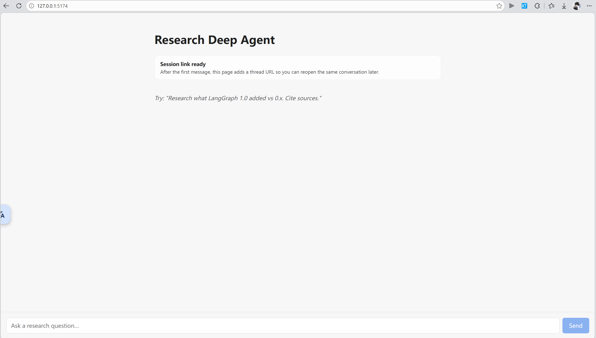
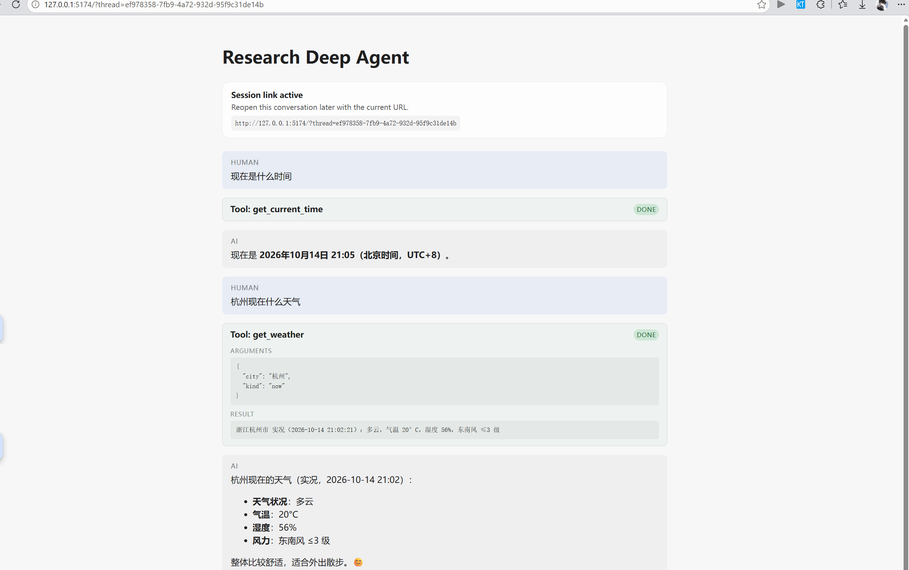
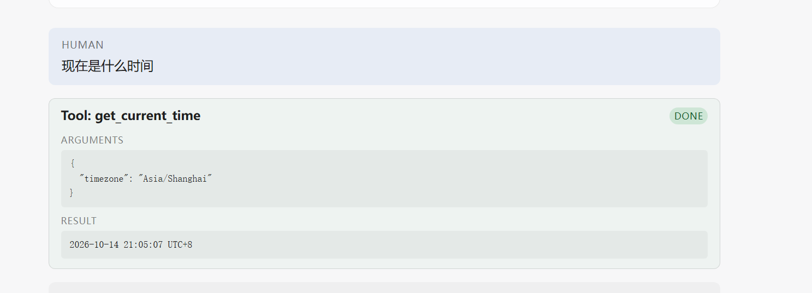

# 第1-2章：我的第一个工具 Agent

> **一句话**：DeepAgent = 模型 + 工具 + 执行循环。本章启动主应用，看清这个循环怎么转，然后亲手加一个工具进去——从函数签名到模型能调用，中间只差「注册」这一步。
>
> **本篇环境**：Windows 11 原生 + Python 3.12 + uv + Node.js LTS。项目 `research_deepagent`，`deepagents==0.7.8`、`agentseek-api==0.2.3`。模型走 SiliconFlow 的 `zai-org/GLM-5.2`。

---

## 一、本章任务

Task1：我的第一个工具 Agent。学习第 1-2 章，读架构图与执行循环，**启动主应用**并**添加一个自己的工具**。

拆成两件可验证的事：

1. 主应用能起来，前后端连通
2. 自己写的工具能被模型**真实调用**

第二件的证据**不是**「它答对了」——模型可以凭常识蒙对时间。真正的证据是 UI 上那张工具卡片。

---

## 二、启动主应用

```bash
# 一条命令同时起前后端
uvx agentseek dev
```

也可以分开起，日志更清楚（我用的是这个）：

```bash
uv run agentseek-api dev --port 2024    # 后端 LangGraph
cd frontend && npm run dev              # 前端 Vite
```

| 服务 | 地址 | runtime |
|---|---|---|
| 后端 LangGraph | `http://127.0.0.1:2024` | agentseek-api |
| 前端 | `http://127.0.0.1:5174` | vite |



页面出现 `Session link ready`，说明前端已连上后端。

**注意这时候页面是空的**——一个工具卡片都没有。因为还没有人调用过任何工具。工具卡片是「调用发生」才产生的，不是启动时就列在那里的。

---

## 三、执行循环：一圈里到底发生了什么

这一节是「读架构图与执行循环」的落点。

四个角色：

| 角色 | 干什么 |
|---|---|
| **模型** | 只生成文本，或**提出**一个带参数的工具调用。**它不执行任何东西** |
| **工具** | 一个普通 Python 函数 |
| **框架** | 收到调用请求 → 真正执行函数 → 把返回值包成 `ToolMessage` |
| **Agent** | 把上面几步串成循环，直到模型不再要求调用工具 |

一圈的时序：

```text
用户提问
   ↓
模型看到 [系统提示 + 工具清单 + 历史消息]
   ↓
模型输出 tool_call:  get_weather({"city": "杭州", "kind": "now"})
   ↓
框架执行 get_weather(city="杭州", kind="now")     ← 真跑你的 Python 函数
   ↓
返回值包成 ToolMessage，回灌给模型
   ↓
模型读到结果，生成最终回答
```

**最关键的一条认知：模型看不到你的 Python 代码。**

它能看到的只有框架从函数签名生成的 **JSON Schema**。所以「模型为什么知道该填 `city`」这个问题的答案，不在提示词里——在函数签名和 docstring 里。下一节展开。

---

## 四、写一个自己的工具

我要加的是**天气查询**，走高德地图的天气 API。它在研究型 Agent 里的位置很明确：现场信息不在模型训练数据里。

完整代码（`src/research_deepagent/my_tools.py`）：

```python
import os

import httpx
from langchain_core.tools import tool
from typing_extensions import Literal

AMAP_WEATHER_URL = "https://restapi.amap.com/v3/weather/weatherInfo"


@tool(parse_docstring=True)
def get_weather(
    city: str,
    kind: Literal["now", "forecast"] = "now",
) -> str:
    """Get current weather or a multi-day forecast for a Chinese city.

    Use this for any question about today's weather, temperature, humidity or
    the near-term forecast. Live weather is not in your training data.

    Args:
        city: Chinese city name, e.g. '北京', '上海', '杭州'. The
            administrative code (adcode) also works, e.g. '110000'.
        kind: 'now' for current conditions, 'forecast' for the next few days.

    Returns:
        A human-readable weather summary, or a message starting with 'Error:'
        if the lookup failed.
    """
    api_key = (os.getenv("AMAP_API_KEY") or "").strip()
    if not api_key:
        return (
            "Error: AMAP_API_KEY is not set. Put your 高德地图 key in .env "
            "and restart the API."
        )

    params = {
        "key": api_key,
        "city": city,
        "extensions": "base" if kind == "now" else "all",
        "output": "JSON",
    }

    try:
        response = httpx.get(AMAP_WEATHER_URL, params=params, timeout=10.0)
        response.raise_for_status()
        payload = response.json()
    except Exception as exc:
        return f"Error: Amap request failed for {city!r}: {exc!s}"

    if payload.get("status") != "1":
        return (
            f"Error: Amap rejected the request for {city!r}: "
            f"{payload.get('info')} (infocode {payload.get('infocode')})"
        )

    if kind == "now":
        lives = payload.get("lives") or []
        if not lives:
            return f"Error: Amap returned no current weather for {city!r}."
        live = lives[0]
        return (
            f"{live.get('province')}{live.get('city')} 实况"
            f"（{live.get('reporttime')}）："
            f"{live.get('weather')}，气温 {live.get('temperature')}°C，"
            f"湿度 {live.get('humidity')}%，"
            f"{live.get('winddirection')}风 {live.get('windpower')} 级"
        )

    forecasts = payload.get("forecasts") or []
    if not forecasts:
        return f"Error: Amap returned no forecast for {city!r}."
    forecast = forecasts[0]
    lines = [f"{forecast.get('city')} 预报（更新于 {forecast.get('reporttime')}）："]
    for cast in forecast.get("casts") or []:
        lines.append(
            f"  {cast.get('date')} 周{cast.get('week')}："
            f"白天 {cast.get('dayweather')} {cast.get('daytemp')}°C，"
            f"夜间 {cast.get('nightweather')} {cast.get('nighttemp')}°C"
        )
    return "\n".join(lines)
```

Key 放 `.env`（该文件已被 gitignore）：

```ini
AMAP_API_KEY=<your-amap-web-service-key>
```

> **坑点**：高德创建 key 时类型必须选 **「Web 服务」**，不能选「Web端(JS API)」。选错了即使 key 有效也会返回 `INVALID_USER_KEY`。

### 4.1 模型看到的到底是什么

把 schema 打出来：

```bash
uv run python -c "import json; from research_deepagent.my_tools import get_weather; print(json.dumps(get_weather.tool_call_schema.model_json_schema(), indent=2, ensure_ascii=False))"
```

真实输出：

```json
{
  "description": "Get current weather or a multi-day forecast for a Chinese city. Use this for any question about today's weather, temperature, humidity or the near-term forecast. Live weather is not in your training data.",
  "properties": {
    "city": {
      "description": "Chinese city name, e.g. '北京', '上海', '杭州'. The administrative code (adcode) also works, e.g. '110000'.",
      "title": "City",
      "type": "string"
    },
    "kind": {
      "default": "now",
      "description": "'now' for current conditions, 'forecast' for the next few days.",
      "enum": ["now", "forecast"],
      "title": "Kind",
      "type": "string"
    }
  },
  "required": ["city"],
  "title": "get_weather",
  "type": "object"
}
```

**这份 schema 就是模型眼里的全部。** 三个来源对应关系：

| Schema 里的东西 | 来自哪里 |
|---|---|
| 整个函数的 `description` | docstring 的第一段 |
| 每个参数的 `description` | docstring 的 `Args:` 段（靠 `parse_docstring=True` 解析） |
| 参数 `type` / `required` / `default` | 类型标注和默认值 |

几个可以直接读出来的结论：

- `city` 在 `required` 里 —— 因为它没有默认值，模型**必须**填
- `kind` 不在 `required` 里 —— 因为它 `= "now"`，模型可以不填
- `kind` 多了个 `enum: ["now", "forecast"]` —— 这是 `Literal` 类型自动带来的约束，模型只能在这两个值里选
- 中文示例 `'北京', '上海', '杭州'` 出现在描述里 —— 所以模型拿到「杭州天气怎么样」时，知道该往 `city` 里填中文城市名

**没有任何地方硬编码「杭州」。** 模型是从我的提问里提取出地名、再按 schema 填进去的。

### 4.2 四条约定

1. **返回值必须是 `str`** —— 它会被包成 `ToolMessage` 回灌给模型，模型读到的是文本
2. **出错要 `return` 错误字符串，绝不 `raise`** —— 抛异常会直接打断 agent 循环，模型连「我失败了」都看不到（见第七节踩坑 3）
3. **docstring 的 `Args:` 段格式要对齐** —— `parse_docstring=True` 靠它生成参数描述
4. **默认值 = 可选参数**

---

## 五、注册：这一步不能漏

工具写完**不会自动生效**。要把它挂到图上。

`src/research_deepagent/agent.py` 两处改动：

```python
# 1) 导入
from research_deepagent.my_tools import get_current_time, get_weather

# 2) build_graph 里注册
def build_graph(chat_model, *, checkpointer=None):
    return create_deep_agent(
        model=chat_model,
        middleware=[TodoListMiddleware()],
        tools=[tavily_search, think_tool, get_current_time, get_weather],   # ← 就是这里
        system_prompt=INSTRUCTIONS,
        subagents=[research_sub_agent],
        checkpointer=checkpointer,
    )
```

**为什么必须改这里**：`langgraph.json` 声明的图是 `agent.py:graph`：

```json
"graphs": { "research": "./src/research_deepagent/agent.py:graph" }
```

而文件末尾是 `graph = build_graph(model)`。所以 `build_graph` 的 `tools=[...]` 才是真正的注册点，光写个函数文件没有用。

改完**必须重启后端**——`graph` 是模块级构建的，导入时就定型了。

**子 agent 是独立的。** `research-agent` 的工具写在 `research_sub_agent["tools"]` 里，主 agent 注册了不会自动继承：

```python
research_sub_agent = {
    "name": "research-agent",
    ...
    "tools": [tavily_search, think_tool],   # 这里没有 get_weather
}
```

**前端完全不用改。** 卡片组件对任何工具名都通用渲染，新工具自动出现。

---

## 六、验证：模型真的调用了



这张图怎么读：

- **`Tool: get_weather` 卡片存在** —— 运行时确实执行了这次调用。**模型可以在文本里声称「我查了一下」，但伪造不出这张卡片**，因为卡片是框架根据真实调用渲染的
- **绿色 `DONE`** —— 工具返回了结果，不是抛错或还在跑
- **展开的 `ARGUMENTS`** → `{"city": "杭州", "kind": "now"}` —— 模型自己填的，我没硬编码
- **`RESULT`** → `浙江杭州市 实况（2026-10-14 21:02:21）：多云，气温 20°C，湿度 56%，东南风 ≤3 级`



> **卡片在完成时会自动折叠。** 想看参数和返回值，需要点一下展开。

### 一个值得警惕的观察

模型的最终回答里写了「**整体比较舒适，适合外出散步 😊**」。

**这句话不是工具返回的。** 工具只给了「多云、20°C、湿度 56%、东南风 ≤3 级」。「舒适、适合散步」是模型自己从数据推断出来的，属于工具结果**之外**的内容。

由此得到一条重要区分：

> **卡片证明的是「工具被调用了」，不是「模型的最终答案忠实使用了工具结果」。**

模型完全可以调用工具、然后无视返回值自己编一个。核对时要做的事是：**拿答案里的关键数字，回到卡片的 `RESULT` 去比对。** 对上了才算闭环——光看问答通顺不算，那可能只是碰巧。

---

## 七、踩坑记录

以下都是这次实际踩到的，不是预想的。

### 1. 高德的错误是 HTTP 200

高德 API 失败时**不返回 4xx/5xx**，而是 HTTP 200 + 响应体里 `"status": "0"`：

```json
{"status": "0", "info": "INVALID_USER_KEY", "infocode": "10001"}
```

**只看 `raise_for_status()` 会把失败当成功**，然后去解析空数组崩掉。所以代码里额外加了这一层：

```python
if payload.get("status") != "1":
    return f"Error: Amap rejected the request for {city!r}: ..."
```

这个坑是拿假 key 试出来的——请求真的打到了高德服务器，返回 `INVALID_USER_KEY (infocode 10001)`，正好验证了错误分支是通的。

### 2. 无效城市名：`status` 是 `"1"`，但 `lives` 是空数组

实测传一个不存在的城市名：

```bash
uv run python -c "from research_deepagent.my_tools import get_weather; print(repr(get_weather.invoke({'city': '不存在的城市xyz'})))"
```

返回的**不是错误码**，而是 `status: "1"`（成功）+ `lives: []`（空数组）。

所以**光查 `status` 不够，还得查数组是否为空**：

```python
lives = payload.get("lives") or []
if not lives:
    return f"Error: Amap returned no current weather for {city!r}."
```

两处都要查，缺一个都会让模型收到一个空字符串然后开始瞎编。

### 3. 工具里不能 `raise`

所有失败分支都是 `return "Error: ..."` 而不是 `raise`。原因：**抛异常会直接打断 agent 循环**，模型连「工具失败了」这个信息都收不到，只会看到流程中断。返回字符串则让它能读到失败原因，自己决定重试、换个城市、还是如实告诉用户查不到。

### 4. Windows 上嵌入式 seekdb 起不来

`agentseek-api dev` 启动失败，报：

```text
RuntimeError: Embedded Client is not available because pylibseekdb is not available.
Please install pylibseekdb (Linux only) or use RemoteServerClient (host/port) instead.
```

**`pylibseekdb` 只有 Linux 包**，所以模板默认的 `SEEKDB_EMBED=true` 在 Windows 上永远起不来。改用 SQLite 元数据后端：

```ini
SEEKDB_EMBED=false
METADATA_DB_BACKEND=sqlite
METADATA_DB_URL=sqlite+aiosqlite:///./.agentseek/metadata.db
```

两个额外发现：

- **`agentseek doctor` 对此会误报 `ok`**。它只检查 `SEEKDB_EMBED` 这个变量「有没有配」，不检查后端能不能真启动。**doctor 全绿不等于服务能起来**，起不来要去看启动日志
- 代价：非嵌入模式下 LangGraph 的 checkpointer 走 `InMemorySaver`，**重启后 checkpoint 不落盘**（AgentSeek 自己的 metadata 和 store 仍持久化在 SQLite）

### 5. `bind_tools` 是懒调用

想看「图里到底注册了哪些工具」，用脚本化模型拦截 `bind_tools` 记录清单——但光构建图拿到的清单是**空的**：

```python
model = ScriptedModel(replies=[AIMessage(content="ok")])
build_graph(model)
print(model.seen_tools)   # []  ← 空的
```

必须**真的跑一次**才会触发：

```python
list(graph.stream({"messages": [{"role": "user", "content": "hi"}]},
                  {"configurable": {"thread_id": "introspect"}},
                  stream_mode="values"))
print(model.seen_tools)   # 12 个工具
```

主 agent 实际绑定 **13 个**工具：

| 来源 | 数量 | 工具 |
|---|---|---|
| deepagents 内置（文件操作） | 8 | `ls` `read_file` `write_file` `edit_file` `glob` `grep` `delete` `task` |
| Planning 中间件 | 1 | `write_todos` |
| 本项目 | 4 | `tavily_search` `think_tool` `get_current_time` `get_weather` |

其中 `task` 是子 agent 委派入口，`write_todos` 是 `middleware=[TodoListMiddleware()]` 注册进来的——**这些都不是我写的代码，是框架给的**。真正属于本项目的工具只有最后 4 个。

---

## 八、本章完成结果

- 主应用跑通：后端 `127.0.0.1:2024` + 前端 `127.0.0.1:5174`，浏览器可交互
- 看懂执行循环一整圈：模型提出调用 → 框架执行函数 → `ToolMessage` 回灌 → 模型作答
- 亲手添加工具 `get_weather`（高德天气 API），含实况与预报两种模式
- 理清「函数签名 + docstring → JSON Schema → 模型填参」这条链路，全程无硬编码
- 分清「工具被调用」与「答案忠实使用结果」这两件事

---

## 参考

- 教程第 2 章：[第 2 章：快速上手](https://datawhalechina.github.io/deepagents-in-action/chapters/ch02-quickstart/)
- 课程仓库：[datawhalechina/deepagents-in-action](https://github.com/datawhalechina/deepagents-in-action)
- 高德天气 API 文档：[天气查询](https://lbs.amap.com/api/webservice/guide/api/weatherinfo)
