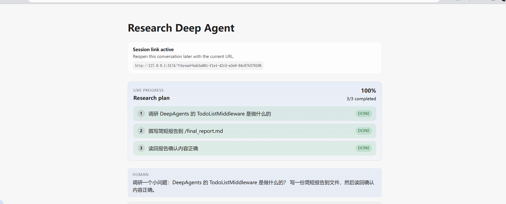
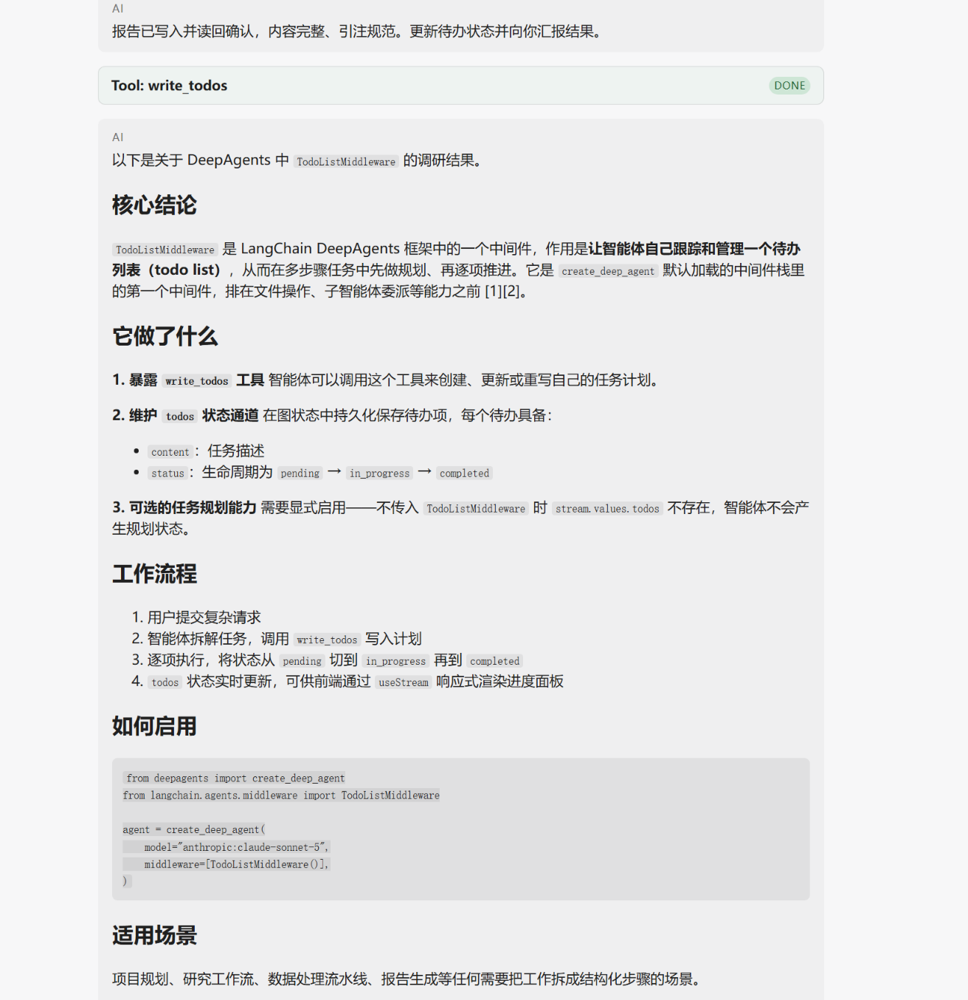
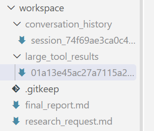

# 第3章：让成果留在文件里

> **一句话**：文件工具一直都有，只是以前写到了我看不见的地方。改一个后端参数，文件就落到磁盘上了。
>
> **本篇环境**：Windows 11 原生 + Python 3.12 + uv + Node.js LTS。项目 `research_deepagent`，`deepagents==0.7.8`。

---

## 一、本章任务

Task2 要求学第 3 章，沿用模板的文件后端，把资料和报告**保存、读回、修改**。落到我这儿是三件事：

1. 看懂第 3 章的虚拟文件系统
2. 让 agent 写的文件真的存在于磁盘上
3. 自己提问跑一遍，在文件夹里确认

---

## 二、原来的文件写到哪儿去了

改之前 `build_graph` 没有传 `backend`：

```python
def build_graph(chat_model, *, checkpointer=None):
    return create_deep_agent(
        model=chat_model,
        middleware=[TodoListMiddleware()],
        tools=[tavily_search, think_tool, get_current_time, get_weather],
        system_prompt=INSTRUCTIONS,
        subagents=[research_sub_agent],
        checkpointer=checkpointer,
    )
```

不传的话框架会自己兜底，`deepagents/graph.py:627` 是这么写的：

```python
backend = backend if backend is not None else StateBackend()
```

`StateBackend` 把文件存进 agent state。所以那时候 `write_file` 返回成功、界面上显示完成、模型也能把内容复述出来，但文件在 checkpoint 里，磁盘上没有——我在项目目录里翻了一圈也没找到。

它的报错信息把这件事说得很直白，我在脚本里单独调用时拿到过：

```text
RuntimeError: StateBackend must be used inside a LangGraph graph execution ...
To pre-populate files, pass them on invoke: agent.invoke({"messages": [...], "files": {...}})
```

`files` 是 `invoke` 的一个入参。文件属于状态，不属于磁盘。

---

## 三、第 3 章讲的是什么

第 3 章叫虚拟文件系统。我本来以为要去加文件工具，其实不用——`ls`、`read_file`、`write_file`、`edit_file`、`glob`、`grep`、`delete` 这 7 个在 Task1 做的时候就已经注册好了，我这次一个都没加。

**虚拟的是路径，不是文件。** agent 全程只认这种写法：

```text
agent 看到的：  /final_report.md
实际的：        ...\research_deepagent\workspace\final_report.md
```

这层对应关系由 backend 负责。所以要动的地方只有一个：这个虚拟路径背后接到哪儿。

---

## 四、改的地方

`src/research_deepagent/agent.py`，加了 `WORKSPACE_DIR` 和 `backend` 参数：

```python
WORKSPACE_DIR = Path(__file__).resolve().parents[2] / "workspace"


def build_graph(chat_model, *, checkpointer=None, backend=None):
    if backend is None:
        backend = FilesystemBackend(root_dir=WORKSPACE_DIR, virtual_mode=True)
    return create_deep_agent(
        model=chat_model,
        middleware=[TodoListMiddleware()],
        tools=[tavily_search, think_tool, get_current_time, get_weather],
        system_prompt=INSTRUCTIONS,
        subagents=[research_sub_agent],
        backend=backend,
        checkpointer=checkpointer,
    )
```

两个地方当时想了一下：

**为什么用 `Path(__file__)` 而不是相对路径。** 相对路径会跟着进程的工作目录走，`agentseek-api dev` 和 pytest 启动的位置不一样，指向的就可能不是同一个地方。钉在文件自己的位置上就不会漂。

**为什么是 `workspace/` 而不是项目根目录。** 因为 `FilesystemBackend` 能读 root 底下的任何文件，而 `.env`（里面是三个真 key）就在项目根目录。我把 root 放在下一层，agent 的文件工具就够不到它了。

另外 `virtual_mode=True` 是默认值，作用是拦住 `..`、`~` 这种越界路径。

---

## 五、跑一遍

我用的提问是：

> 调研一个小问题：DeepAgents 的 TodoListMiddleware 是做什么的？**写一份简短报告到文件**，然后**读回确认内容正确**。

「到文件」和「读回」得明说。只讲「调研一下 TodoListMiddleware」，模型大概率直接在对话里把答案贴给我，不会去碰文件。



记录里能看到它自己拆的三条计划：调研 → 撰写报告到 `/final_report.md` → 读回确认，全部完成。路径是它自己填的，我提问时只说了「文件」，没给路径——路径来自 `prompts.py` 里早就定好的约定。



对话区渲染出了报告，上面还有 `write_todos` 的完成卡片。



`workspace/` 目录里现在有：

```text
workspace/
├── research_request.md     我提的问题被存下来了
├── final_report.md         77 行，结尾带 ### Sources
├── conversation_history/   多出来的，见下一节
├── large_tool_results/     多出来的，见下一节
└── .gitkeep
```

报告结尾引的两条链接，和检索回来的结果对得上，不是模型编的。

有一点我记一下：`research_request.md` 存的内容和我原话不完全一样。我说的是「写一份简短报告到文件，然后读回确认内容正确」，它压成了「撰写简短报告」。它是在执行「保存用户请求」这条指令，只是做了自己的再表述。

---

## 六、多出来的两个目录

`conversation_history/` 和 `large_tool_results/` 不是我建的，是 deepagents 自带的自动上下文管理写的。

`conversation_history/` 里是一个 `.md`，记着这次运行的原始消息流，被摘要的对话按时间戳分节追加在里面。我打开看了一眼，好几次 `## Summarized at ...`。

`large_tool_results/` 里那个 119 KB 的文件，是被卸载的一次工具结果。规则是工具返回值超过约 8 万字符就不再进入上下文，改成写到文件里，只在消息里留路径和头尾各几行的预览，模型需要时自己用 `read_file` 分页读回来。它的文件名就是那次调用的 id——我在 `conversation_history` 里找到了对应的那行 `tavily_search`，id 一字不差。

这两个目录以前也一直在生成，只是写在 state 里，磁盘上看不到。换成文件后端之后，它们才露出来。调试的时候这个比对话记录有用，因为里面是没经过模型转述的原始消息。

---

## 七、踩到的坑

**写文件成功不等于文件在磁盘上。** 最容易踩的一条，判断标准得落在文件夹上，不是界面上的绿色完成。

**`.gitignore` 里 `workspace/` 和 `workspace/*` 不是一回事。** 我想要的是目录进 git、里面的产物不进。直觉写法是 `workspace/` 再 `!workspace/.gitkeep`，但这样 `.gitkeep` 也进不去——父目录被排除后，里面的文件没法再单独包含回来。得写成：

```gitignore
workspace/*
!workspace/.gitkeep
```

**改完必须重启后端。** `graph = build_graph(model)` 是模块级执行的，导入时就定型了。

---

## 八、一个顺带的确认

换后端之后图没有变化。我把两种后端下的拓扑都打出来对了一遍，都是 6 个节点 7 条边，一模一样。

这跟 Task1 问的「工具是不是节点」是同一个结论：图上始终只有 `model` 和 `tools` 这些固定角色，工具和文件路径都只是 `tools` 节点里的表项。`backend` 决定文件存哪儿，不影响图怎么跑。

---

## 九、本章完成结果

- 看懂第 3 章：虚拟的是路径，不是文件，映射由 backend 负责
- 认清 Task2 是换后端，不是加工具——7 个文件工具 Task1 时就已就位
- `build_graph` 加上了 `backend=FilesystemBackend(root_dir=WORKSPACE_DIR, virtual_mode=True)`
- 跑通保存 → 读回 → 修改，`research_request.md` 和 `final_report.md` 落盘
- 顺带看清了框架的自动上下文管理：大结果卸载和对话摘要
- 补了 3 条测试在 `tests/test_file_backend.py`

---

## 参考

- 教程第 3 章：[虚拟文件系统](https://datawhalechina.github.io/deepagents-in-action/chapters/ch03-virtual-filesystem/)
- 课程仓库：[datawhalechina/deepagents-in-action](https://github.com/datawhalechina/deepagents-in-action)
- git 忽略规则：[gitignore(5)](https://git-scm.com/docs/gitignore)
