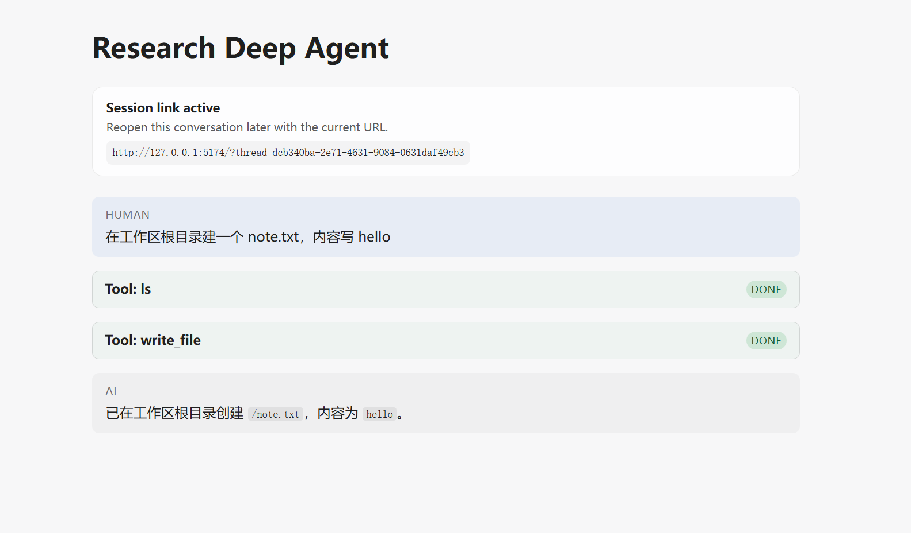
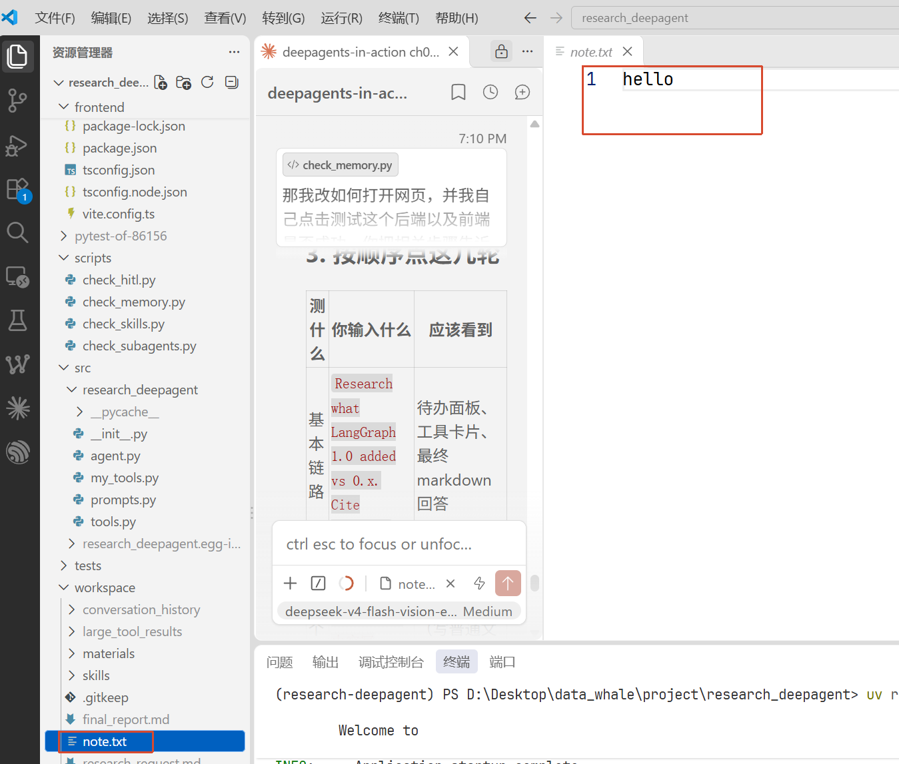
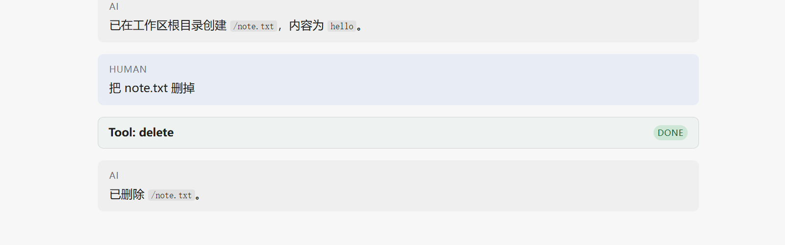
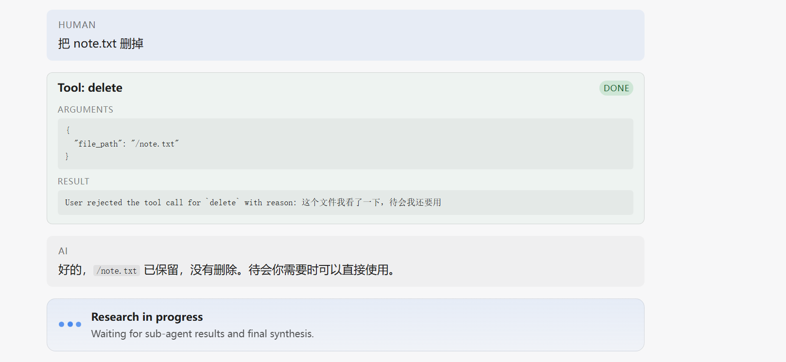
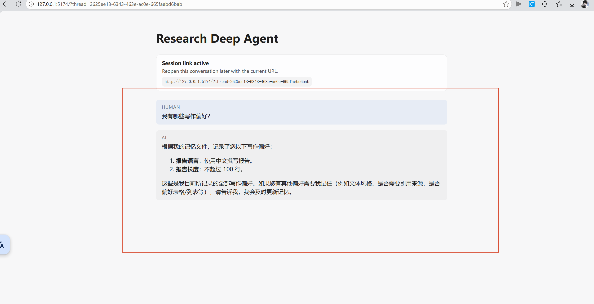
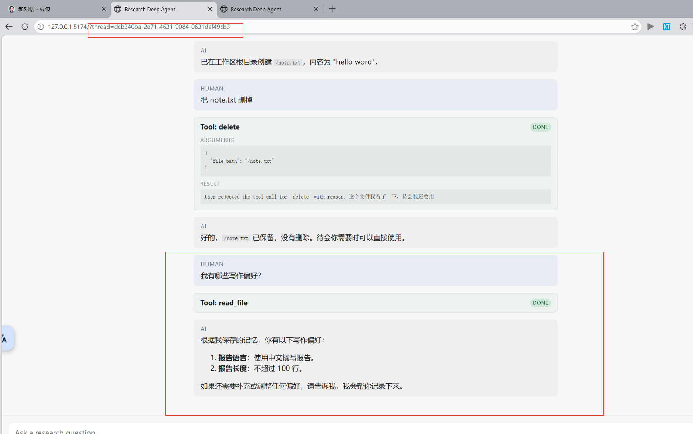

# 第8–9章：记住用户偏好，执行前先问一句

## 一、这次的任务

Task6 的原话是：

> 今天的学习内容是 Task6：记住用户偏好，执行前等待审批。学习第 8–9 章，以文件记忆为起点，并完成本地工具审批实验。

拆开就是两件事：

- **第 8 章**：让 Agent 记住一件事，而且换一次对话还记得。
- **第 9 章**：遇到有风险的操作（删文件、改记忆），先停下来问人。

这两件事在我的项目里是连在一起的：记忆写的是长期状态，所以"写记忆"这个动作本身，也得先审批。

## 二、第 8 章：长期记忆是怎么做的

### 记忆为什么又变成了"文件"

对话消息只活在这一次 thread 里，thread 一换就没了。想让"下次还记得"，就得把结论抄到 thread 外面去。

Deep Agents 的办法很朴素：**还是当成文件，只不过这个文件不住在硬盘上，住在 Store 里**。对模型来说没区别，它照样用 `read_file`、`edit_file` 去读写；对系统来说，这些文件不随对话消失。

我给后端加了两条"路由"：

```python
routes={
    "/memories/": StoreBackend(namespace=memory_namespace),  # 每人一份
    "/global/":   StoreBackend(namespace=global_namespace),  # 大家共用
}
```

模型看到的路径长这样：`/memories/preferences.md`。前面那个 `/memories/` 只是门牌号，告诉它去哪个柜子；真正存进 Store 的 key 是 `/preferences.md`。

两种作用域的分工：

| 路径 | 给谁看 | 放什么 |
|---|---|---|
| `/memories/preferences.md` | 当前用户 | 个人偏好：写中文、不超过多少行、格式习惯 |
| `/global/AGENTS.md` | 所有人 | 这个 Agent 该怎么干活 |

### 记忆怎么"自动"进对话

配置里写上这一句就够了：

```python
memory=[MEMORY_PATH, GLOBAL_MEMORY_PATH]
```

每个新对话开始时，`MemoryMiddleware` 会把这两份文件的内容拼进 system prompt。不需要模型自己想起来去读。

**这里踩了一个坑**：文件不存在的时候，它是**静默跳过**的，不报错、不创建。第一次跑，Store 是空的，模型找不到我指定的文件，就自己编了一个 `/user_preferences.md` 写进去。解决办法是在建图时先把两个空壳文件放好（`seed_memory()`），把它"扶"到正确的路径上。

## 三、第 9 章：执行前审批

思路一句话：**有风险的调用先停住**。图保存一份现场就退出，等人给答复，再从现场接着跑。

人能给的答复有三种：

| 决定 | 意思 |
|---|---|
| approve | 照做 |
| edit | 改一下参数再照做 |
| reject | 不做了。可以附一句理由，这句会作为工具结果回到模型 |

我拦了三类动作：

```python
INTERRUPT_ON = {
    "delete":     {"allowed_decisions": ["approve", "reject"]},
    "write_file": {"allowed_decisions": ["approve", "edit", "reject"], "when": writes_memory},
    "edit_file":  {"allowed_decisions": ["approve", "edit", "reject"], "when": writes_memory},
}
```

`when` 是个过滤器：只有路径以 `/memories/` 或 `/global/` 开头时才停下来问。普通文件照样直接写——`note.txt` 那种创建动作不该打断人。

前端补了一张审批卡片。它出现的时候输入框会禁用，否则会在一个已经暂停的线程上再起一个 run；点完决定，用 `submit(null, {command: {resume: {decisions}}})` 把答复送回去。

## 四、真机走一遍

**1. 先建个文件。** 我说"在工作区根目录建一个 note.txt，内容写 hello"，它直接调了 `write_file`，**没有弹审批**——符合设计。



磁盘上确实有这东西：



**2. 再让它删。** 这次弹出「需要你的批准」，点批准后 `delete` 才真的执行。



**3. 换个决定试试拒绝。** 理由写"这个文件我看了一下，待会我还要用"，文件就保住了，而且这句理由原样出现在工具结果里，模型据此回话。



**4. 写记忆也要审批。** 我说"记住我的偏好：报告用中文写，不超过 100 行"，弹出来的是 `edit_file` 的卡片，三个按钮齐全。



**5. 换个页面再问。** 我新开了一个页面问"我有哪些写作偏好？"，它先 `read_file` 读了记忆文件，然后答出中文、100 行两条。



## 五、怎么证明它不是嘴上说说

截图只能证明"看起来对"。要证明"真的对"，得看模型没法控制的地方——磁盘和状态。

写了两个脚本，都在项目根目录跑：

```powershell
uv run python scripts/check_hitl.py
uv run python scripts/check_memory.py
```

`check_hitl.py` 看的是**文件到底还在不在**：

```
1) 拒绝删除
  paused on delete {'file_path': '/hitl-demo.txt'}
  exists after reject: True
2) 批准删除
  exists after approve: False
OK: 同一个请求，拒绝就不执行，批准才执行
```

`check_memory.py` 看的是**新对话到底有没有拿到记忆**。它读的不是模型的回答，是 `graph.get_state(thread).values["memory_contents"]`——也就是 middleware 真正拼进 system prompt 的那段：

```
loaded into the prompt: /memories/preferences.md -> True
loaded into the prompt: /global/AGENTS.md -> True
global memory in thread C: # 全局记忆 - 所有报告默认用 Markdown 格式。
OK
```

第二个脚本还做了件事：它绕开模型，直接往全局记忆里写一条，再看新对话读不读得到。这样测的是"加载机制"，而不是"模型愿不愿意写"。

## 六、踩到的坑

1. **我的偏好被写进了全局记忆。** 我说的是"我的偏好"，它却写进了 `/global/AGENTS.md`，那是所有人共享的地方。翻了下代码才明白：`agent.py` 里写着两种记忆该放什么，但那是写给人看的注释，**系统提示词里一个字都没提**，模型只能自己猜，就猜了全局那份。要让它在正确的柜子里放东西，得把规则写进提示词。

2. **记忆文件不存在时，middleware 静默跳过。** 不报错、不提醒，模型就会自己编一个路径。预置空文件是必须的。

3. **Store 现在是内存里的。** 服务一重启，记忆就没了。课程里说这是开发阶段的做法，上生产要换成 `PostgresStore`。所以"重启后还记得"这件事，目前做不到，也不该拿它当 bug。

4. **路径前缀会被剥掉。** `CompositeBackend` 把 `/memories/` 去掉再交给 `StoreBackend`，所以 Store 里的 key 是 `/preferences.md`。写键名时多带一段前缀，就会变成 `/memories/memories/preferences.md`。

5. **中断里的参数键名有两种。** 前端拿到的 `action_requests` 里，参数有时叫 `args`，有时叫 `arguments`（用"改参数"这个决定提交时是 `args`）。卡片里两种都认。

6. **被拒绝的调用仍显示 DONE。** 看第 3 张图，工具结果写着"用户拒绝"，徽章还是绿色的 DONE。自己用的时候知道怎么回事，但第一眼看容易误会，前端可以再加一个"已拒绝"状态。

## 七、这次改了什么

- [✅] `agent.py`：两条路由（个人 / 全局）、启动时预置记忆文件、`memory=[...]`、`interrupt_on` 三类动作
- [✅] 前端：审批卡片（批准 / 改参数 / 拒绝），暂停时禁用输入框
- [✅] 两个验证脚本：`check_hitl.py`、`check_memory.py`
- [ ] 提示词补上"两种记忆分别放什么"（发现了问题，还没改）

## 八、一句话总结

第 8 章解决的是"记住"：**把结论从对话里搬到一个不会随对话消失的地方**。
第 9 章解决的是"敢让它动手"：**有风险的动作用前先停一下，人说了算**。
两章合起来就是 Task6 那句话——记住偏好，执行前等待审批。

## 参考

- [第8章：长期记忆](https://datawhalechina.github.io/deepagents-in-action/chapters/ch08-long-term-memory/)
- [第9章：Human-in-the-Loop](https://datawhalechina.github.io/deepagents-in-action/chapters/ch09-human-in-the-loop/)
